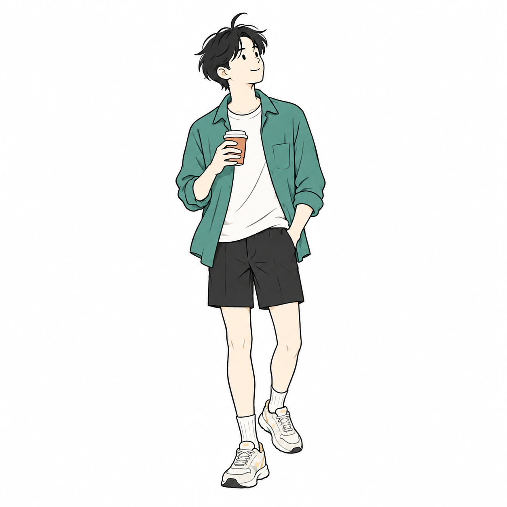
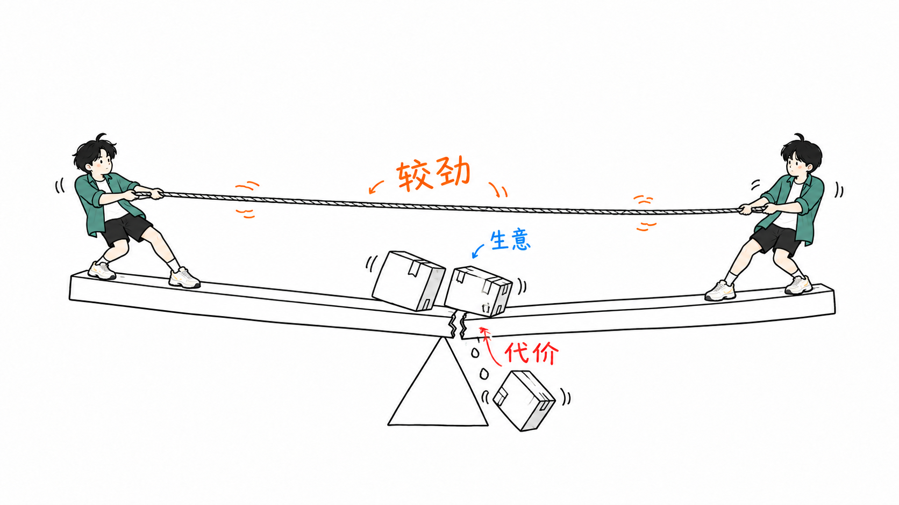
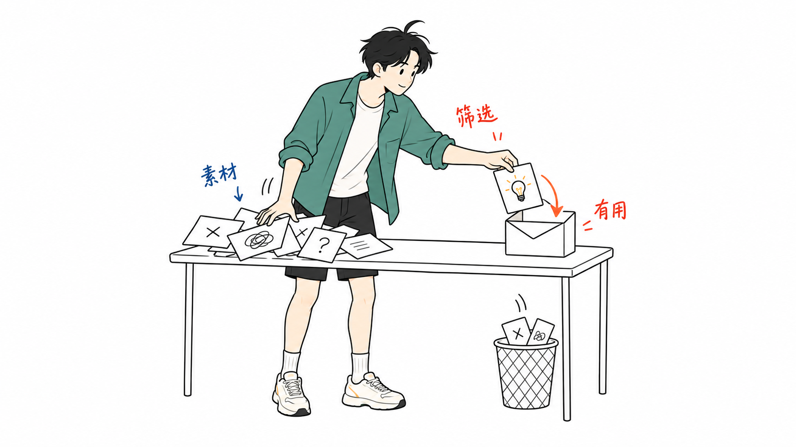
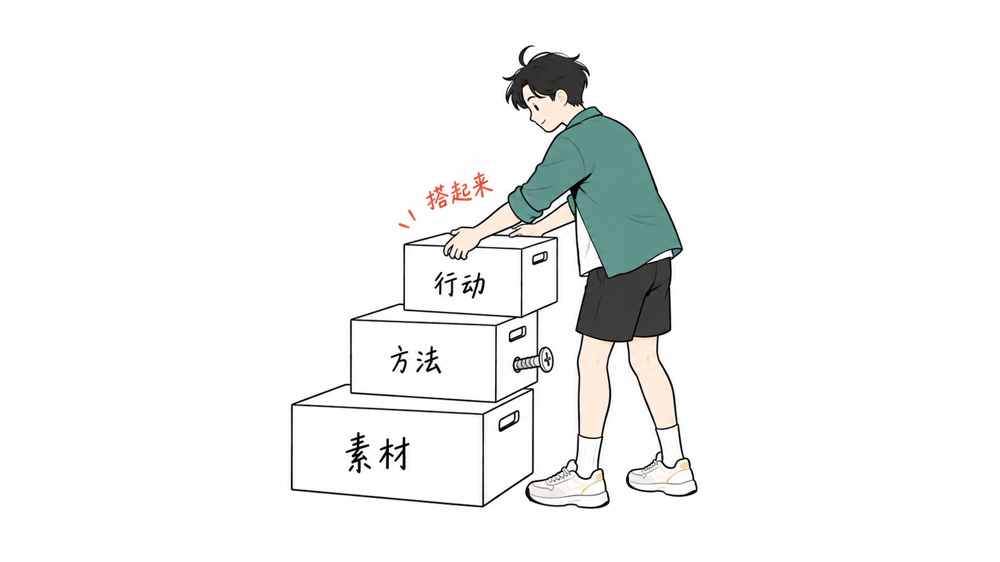
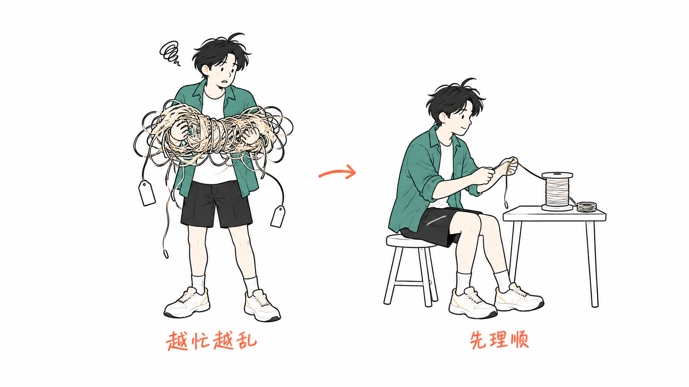
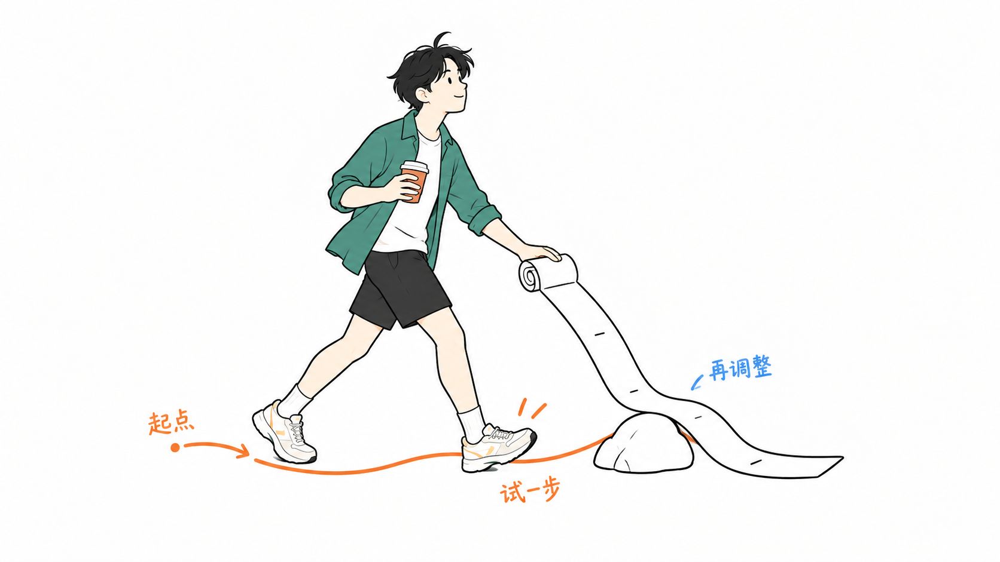
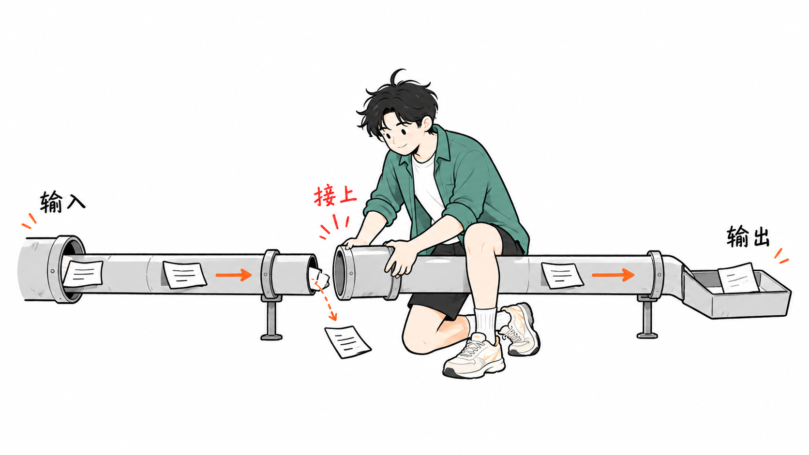
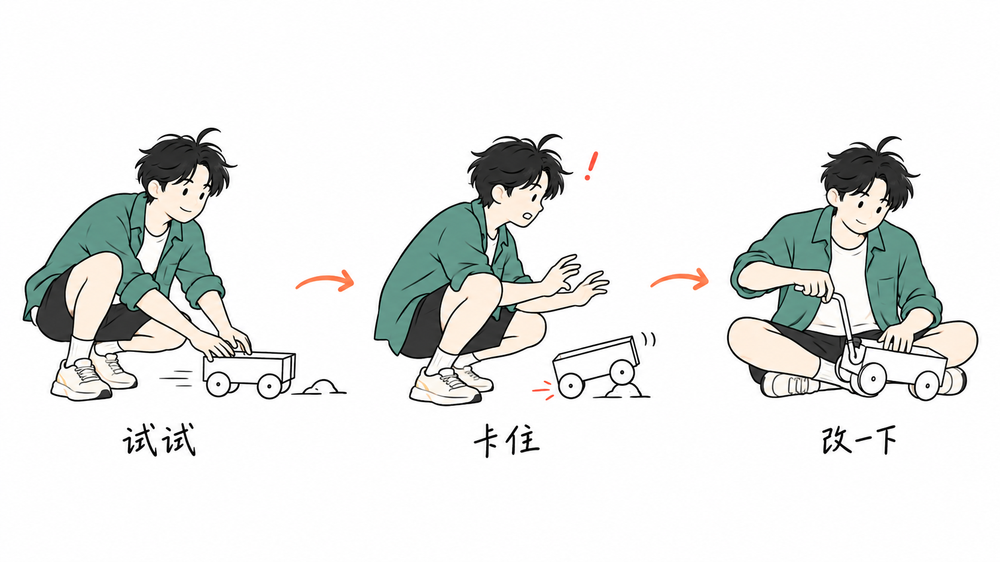

# MHT Illustrations

**MHT 的个人 IP 手绘配图 Skill。**

把文章里的关键观点、流程与抽象关系，变成由 MHT 角色参与的正文插画。适用于中文博客、知识分享、学习笔记和方法论内容：先理解文章，再设计画面，让每张图帮助读者理解一个具体问题。

由 [mht5405](https://github.com/mht5405) 维护。项目仓库：[mht5405/mht-illustrations](https://github.com/mht5405/mht-illustrations)。

## MHT 的角色

<p align="center">
  
</p>

黑色微乱短发与一小撮翘发，玉绿色宽松衬衫、纯白 T 恤、黑色休闲短裤、白袜和运动鞋，构成 MHT 的固定识别特征。角色保留青年人的好奇、专注与行动力，以简练的手绘轮廓呈现。

角色会随文章变换视角、动作与表情：观察、分拣、推拉、搭建、修补、行走或思考。咖啡杯是可选道具，需要双手时就放下；服装没有图案或标识，默认不戴耳机。

基准图用于保持角色身份，**不固定人物站姿，也不要求每张图都像人物展示海报**。讲机制时，让动作、物件关系和结果更醒目；讲人物状态时，可以放大表情与姿态。

## 配图效果

**共同代价 · 概念隐喻**



| 信息筛选 | 方法搭建 |
|---|---|
|  |  |

| 状态对比 | 探索路线 |
|---|---|
|  |  |

| 修补断点 | 试错分镜 |
|---|---|
|  |  |

样例展示同一角色在不同场景中的表现，用于校准角色、动作与画面密度。实际配图从文章重新设计隐喻，不直接套用这些构图。查看[样片索引与逐图说明](ian-xiaohei-illustrations/references/scene-examples.md)。

## 视觉语言与适用场景

- **纯白背景、16:9 横版、大量留白**，方便穿插在正文中。
- **黑色手绘轮廓与克制平涂色**，绿色服装保持角色辨识度；少量红、橙、蓝批注强调问题、路径和反馈。
- **一张图讲一个核心意思**，角色亲自参与动作，画面具有轻微荒诞感和幽默感。
- **人物与道具采用一致的概括程度**，减少五官、衣褶和鞋面细节，让图在正文尺寸下也能读懂。

支持流程、系统局部、前后对比、角色状态、概念隐喻、方法分层、地图路线和小漫画分镜。适合解释观点和关系；不以商业海报、复杂架构图或大段文字信息图为目标。

## 安装

```bash
git clone https://github.com/mht5405/mht-illustrations.git
cd mht-illustrations
mkdir -p "${CODEX_HOME:-$HOME/.codex}/skills"
cp -R ./ian-xiaohei-illustrations "${CODEX_HOME:-$HOME/.codex}/skills/"
```

安装的是仓库内的 Skill 子目录，显示名称为“个人 IP 手绘配图”。为兼容现有安装，子目录和技术调用名暂保留 `ian-xiaohei-illustrations`；该入口加载的默认角色与规则均为 **MHT 个人 IP 版本**。

## 使用

**先做配图规划**

```text
Use $ian-xiaohei-illustrations 分析下面这篇文章哪里值得配图。
使用 MHT 的个人 IP，先输出配图位置、核心意思、人物动作和简短标注，不要生图。

<粘贴文章或提供文件路径>
```

**生成正文插图**

```text
Use $ian-xiaohei-illustrations 为下面这篇文章生成 3 张正文插图。
使用 MHT 的个人 IP，保持白底、简练手绘与留白，每张图只讲一个核心意思。
图片单独保存，先展示效果，不要直接插入原文。

<粘贴文章或提供文件路径>
```

**修改已有配图**

```text
Use $ian-xiaohei-illustrations 修改这张配图。
保留 MHT 角色与核心意思，缩小人物、减少衣褶和鞋面细节，让关键动作更突出。
```

更多示例见 [examples/prompts.md](examples/prompts.md)。

## 生成与交付

Skill 先提炼文章的关键观点与认知转折，再选择适当构图、设计原创物理隐喻，每张图片独立生成。角色基准图用于保持身份一致；场景样片只在需要时作辅助参考。

最终图片保存到工作区的 `assets/<article-slug>-illustrations/`，按 `01-topic-name.png` 顺序命名。是否插入正文按本次任务的明确要求执行；生成后检查中文、人物一致性、动作接触关系和画面主次，需要时局部修改或重生成。

本仓库已包含实际生成的样片和检查记录；新文章仍需逐图检查，不能保证所有场景都一次生成到位。

## 维护与参考

所有运行资源位于 `ian-xiaohei-illustrations/` 子目录：

| 文件 | 用途 |
|---|---|
| [SKILL.md](ian-xiaohei-illustrations/SKILL.md) | 执行入口与配图工作流 |
| [character-ip.md](ian-xiaohei-illustrations/references/character-ip.md) | MHT 角色身份、服装、动作与可变道具 |
| [角色基准图](ian-xiaohei-illustrations/assets/character/green-youth-reference.png) | 默认人物外形与配色依据 |
| [style-dna.md](ian-xiaohei-illustrations/references/style-dna.md) | 画风、颜色、主次和留白 |
| [prompt-template.md](ian-xiaohei-illustrations/references/prompt-template.md) | 生图与编辑提示词 |
| [composition-patterns.md](ian-xiaohei-illustrations/references/composition-patterns.md) | 构图与原创隐喻规则 |
| [qa-checklist.md](ian-xiaohei-illustrations/references/qa-checklist.md) | 生成后的检查与迭代 |
| [scene-examples.md](ian-xiaohei-illustrations/references/scene-examples.md) | 七张 MHT 场景样片及使用边界 |
| [openai.yaml](ian-xiaohei-illustrations/agents/openai.yaml) | 展示名称与默认调用提示 |

生成记录：[场景提示词](examples/personal-ip-generation.json)、[逐图检查](examples/personal-ip-review.json)、[机制图优化提示词与参考角色](examples/refinement-generation.json)。

## 项目来源与许可

MHT Illustrations 基于 [Ian Xiaohei Illustrations](https://github.com/helloianneo/ian-xiaohei-illustrations) 发展，原始 Skill 由 [Ian](https://github.com/helloianneo) 创建。本仓库的个人 IP 定制、角色资源和配套生成规则由 mht5405 维护；保留原项目的归属说明。

原项目示例保存在 `examples/images/` 与 Skill 内的 `assets/examples/`，小黑对比图保存在 `examples/comparison/`。这些是历史或对比素材，不属于当前默认人物参考；默认角色以 MHT 基准图为准。`references/xiaohei-ip.md` 仅保留旧路径兼容说明。

许可与原作者说明见 [LICENSE](LICENSE) 和 [NOTICE.md](NOTICE.md)。
